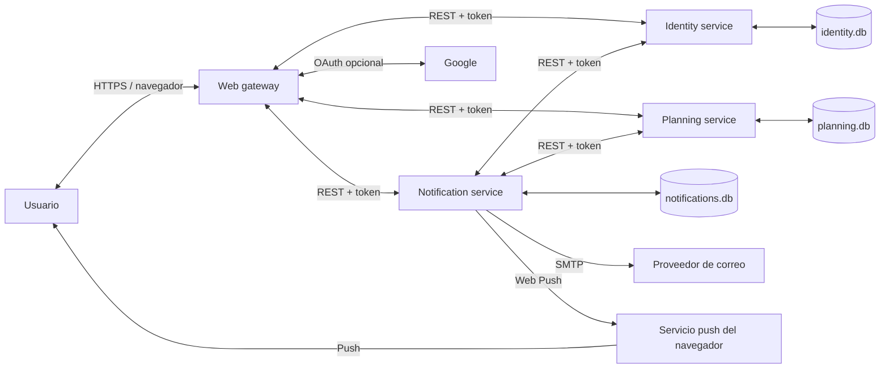
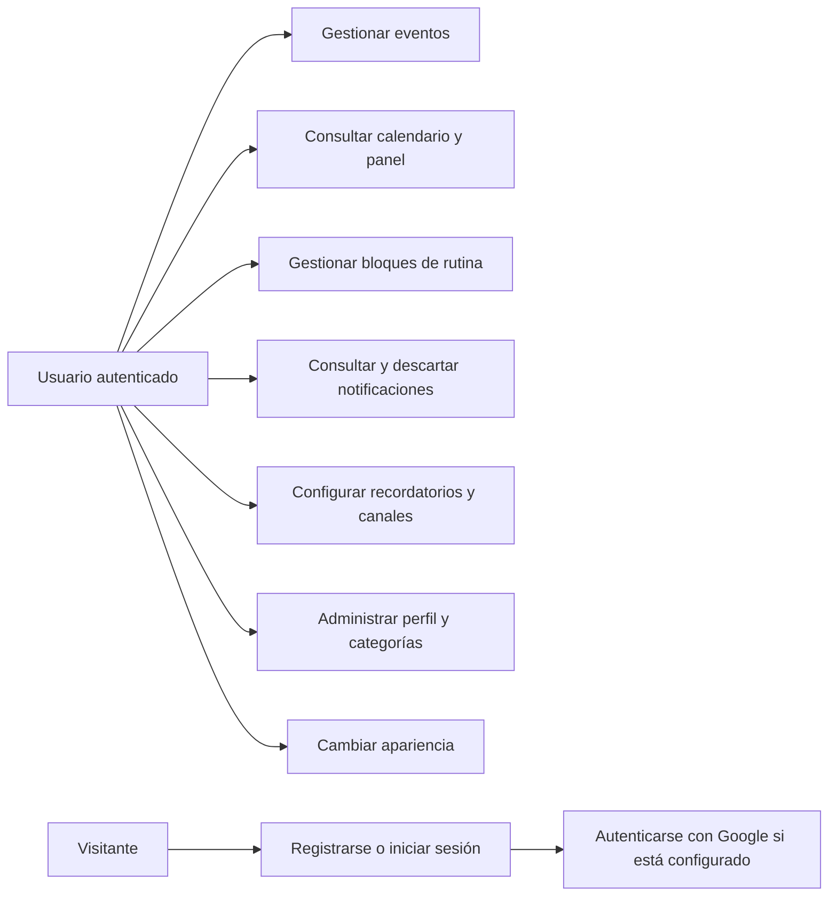
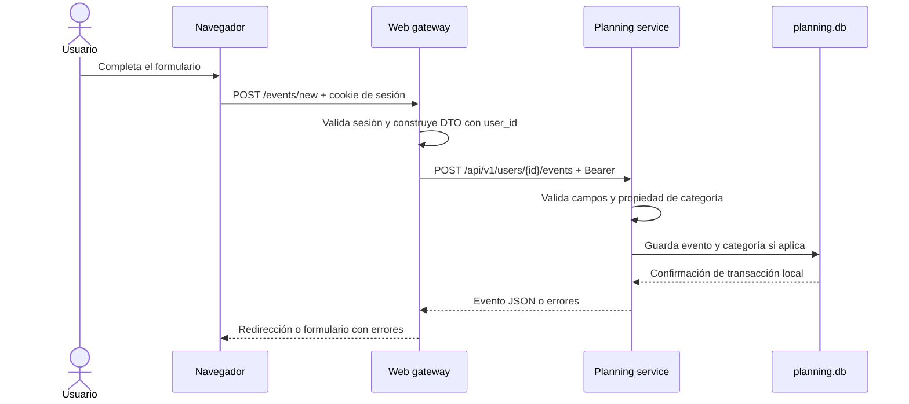
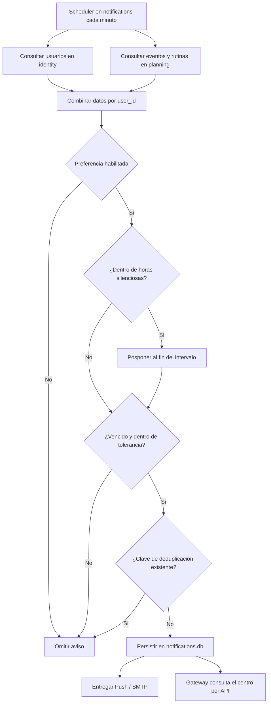
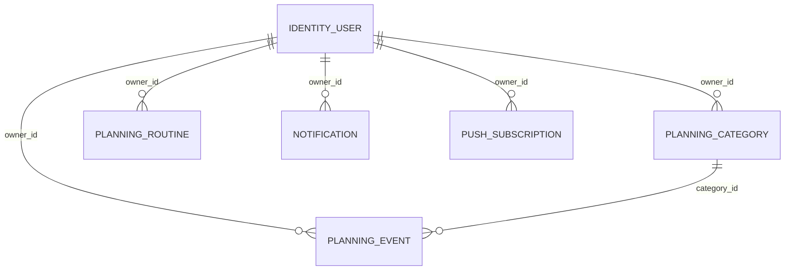

# Arquitectura técnica

## Resumen

Planify se compone de cuatro procesos desplegables: gateway web, identidad, planificación y notificaciones. Cada dominio posee su base SQLite y expone una API REST interna. El gateway conserva solo la sesión web y la interfaz; no abre una base de negocio. Los microservicios también se organizan por capas: separar servicios y separar responsabilidades internas son conceptos complementarios.

Las tecnologías principales son Python, Flask, plantillas Jinja, SQLAlchemy y SQLite. Google OAuth, correo SMTP y Web Push son integraciones opcionales.

## Estructura del código

```text
.
├── app.py                         # Inicio de desarrollo con Flask
├── serve.py                       # Inicio WSGI con Waitress
├── pythonanywhere_wsgi.py         # Adaptador WSGI de PythonAnywhere
├── migrate_to_microservices.py    # Copia de datos desde la base monolítica
├── identity_service/               # Cuenta, credenciales y preferencias
│   ├── app.py                      # API de identidad
│   ├── models.py                   # Base de identidad
│   └── serve.py                    # Proceso independiente
├── planning_service/               # Eventos, categorías y rutinas
│   ├── app.py                      # API de planificación
│   ├── models.py                   # Base de planificación
│   ├── repositories.py             # Consultas por user_id
│   └── serve.py                    # Proceso independiente
├── notification_service/           # Avisos, scheduler, SMTP y Web Push
│   ├── app.py                      # API de notificaciones/entrega
│   ├── models.py                   # Base de notificaciones
│   ├── repositories.py             # Consultas de avisos
│   ├── services.py                 # Casos de uso
│   ├── scheduler.py                # Vencimientos y reintentos
│   ├── delivery.py                 # Adaptadores SMTP/Web Push
│   └── serve.py                    # Proceso independiente
├── planify/
│   ├── __init__.py                # Fábrica de la aplicación
│   ├── config.py                  # Variables de entorno y valores predeterminados
│   ├── extensions.py              # Extensiones compartidas
│   ├── domain/
│   │   ├── models.py              # Entidades ORM
│   │   └── rules.py               # Opciones y validaciones puras
│   ├── application/
│   │   ├── auth_service.py        # Registro y autenticación
│   │   └── services.py            # Casos de uso de agenda y avisos
│   ├── infrastructure/
│   │   ├── microservices.py       # Clientes HTTP internos y DTOs
│   │   ├── database.py            # Persistencia legacy, deshabilitada en modo distribuido
│   │   └── security.py            # Encabezados y errores CSRF
│   ├── presentation/
│   │   ├── routes.py              # Rutas monolíticas de compatibilidad/pruebas
│   │   └── gateway_routes.py      # Rutas HTML del gateway distribuido
│   ├── templates/                 # Vistas Jinja y formularios
│   └── static/                    # CSS, JavaScript y service worker
├── tests/test_app.py              # Pruebas de integración
└── docs/                          # Manual, arquitectura y trazabilidad
```

Los módulos Python incluyen docstrings en español para sus módulos, clases y funciones. Las plantillas, hojas de estilo y JavaScript se describen por responsabilidad y flujo en esta guía.

## Responsabilidades por capa

### Presentación

`planify/presentation/routes.py` registra el blueprint `main`, aplica la autenticación, recibe formularios y coordina los servicios. Las plantillas Jinja presentan panel, calendario, eventos, rutina, notificaciones y configuración. `static/js/app.js` gestiona menú, tema, confirmaciones, permisos y consulta periódica de avisos. `static/service-worker.js` muestra notificaciones push y gestiona su apertura.

Las rutas de acceso, registro y OAuth son públicas. Las demás requieren una sesión autenticada. Las mutaciones se envían mediante POST y están protegidas por CSRF.

### Aplicación

`AuthenticationService` valida y crea cuentas, verifica contraseñas y vincula cuentas Google. `EventService`, `RoutineService`, `CategoryService` y `NotificationService` implementan operaciones de usuario, aplican reglas y delegan consultas en repositorios. Las operaciones personales reciben el identificador de usuario como límite de acceso.

### Dominio

`domain/models.py` define las entidades persistidas. `domain/rules.py` declara categorías iniciales, opciones de recordatorio y validaciones de evento, categoría y bloque.

### Infraestructura

En modo distribuido, `microservices.py` es el único acceso del gateway a los dominios. `database.py`, los repositorios monolíticos y el blueprint `routes.py` se conservan para compatibilidad y pruebas, pero la fábrica no los registra ni crea la base legacy cuando `PLANIFY_MICROSERVICES_ENABLED=true`.

## Servicios y contrato HTTP

| Servicio | Responsabilidad y datos bajo su propiedad | Persistencia |
|---|---|---|
| Web gateway (`app.py`) | HTML, cookie de sesión, CSRF, límites HTTP y traducción de formularios a llamadas REST. | Sin base de dominio; la sesión Flask usa su cookie firmada. |
| `identity_service` | Usuarios, hash de contraseña, vínculo Google y preferencias de recordatorio y canales. | `identity.db`; Docker usa `identity-data`. |
| `planning_service` | Eventos, categorías y bloques semanales. `user_id` es un identificador externo sin FK a identidad. | `planning.db`; Docker usa `planning-data`. |
| `notification_service` | Avisos, deduplicación, estado de lectura, suscripciones push, scheduler y adaptadores SMTP/Web Push. | `notifications.db`; Docker usa `notification-data`. |

Los servicios aceptan llamadas internas autenticadas con `Authorization: Bearer <PLANIFY_SERVICE_TOKEN>`. Rutas principales:

| Endpoint | Contrato | Respuesta |
|---|---|---|
| Identidad: `POST /api/v1/users/register`, `/authenticate`, `/google` | Registro, acceso local o cuenta Google ya validada por el gateway. | Usuario sin hash de contraseña. |
| Identidad: `GET/PATCH/DELETE /api/v1/users/<id>` | Obtener cuenta, editar perfil/credenciales/preferencias y eliminar identidad. | DTO de usuario sin secreto. |
| Planificación: `/api/v1/users/<id>/events`, `/categories`, `/routines` | Crear, consultar, modificar y borrar datos del propietario. | DTOs JSON con fechas y horas ISO. |
| Notificaciones: `/api/v1/users/<id>/notifications`, `/push-subscriptions` | Crear/listar avisos, marcar, descartar y registrar navegadores. | DTOs JSON; claves de deduplicación únicas. |
| Notificaciones: `GET /api/v1/events/due`, `/api/v1/routines/due` | Obtener agenda para el scheduler, vía API de planificación. | Eventos o bloques para calcular vencimientos. |
| Notificaciones: `POST /api/v1/email`, `/api/v1/push` | Entregar correo y Web Push. | Resultado del envío y endpoints expirados. |
| Todos: `GET /health` | Comprobación de vida sin detalles de configuración. | `{"status":"ok"}` |

Cada contenedor valida el mismo token de servicio. Los puertos internos 8100, 8101 y 8102 no se publican en el host; Compose conecta los procesos por DNS interno. El gateway valida sesión del usuario antes de construir DTOs; los servicios validan formato y `user_id` al consultar datos.

La entrega es síncrona. El scheduler y las marcas de reintento de correo pertenecen a notificaciones. No hay cola durable ni entrega exactamente-una-vez entre procesos; la clave única de deduplicación protege creación repetida de avisos. Fallos entre varias bases se tratan como operaciones distribuidas, no como una transacción SQL común.

## Diagrama de contexto



Cada base es propiedad de un solo servicio. Los demás procesos acceden a los datos mediante APIs; no existen joins ni transacciones SQL entre bases.

## Diagrama de casos de uso



## Secuencia: crear un evento



Cada servicio confirma solo su propia base. El token interno no sustituye la autorización de usuario: el gateway obtiene `user_id` de la sesión, y planning filtra cada consulta por ese identificador.

## Flujo: generación de recordatorios



El scheduler se ejecuta en el servicio de notificaciones. Compose debe mantener una sola réplica de ese servicio mientras APScheduler está integrado; escalarlo horizontalmente requerirá un scheduler líder o una cola con idempotencia compartida.

## Rutas HTTP

| Ruta | Métodos | Función |
|---|---|---|
| `/login`, `/register` | GET, POST | Acceso y creación de cuenta. |
| `/auth/google`, `/auth/google/callback` | GET | Inicio y retorno OAuth, si se configura. |
| `/forgot-password` | GET | Pantalla informativa; no envía restablecimientos. |
| `/logout` | POST | Cierre de sesión. |
| `/`, `/calendar` | GET | Panel y calendario mensual de eventos. |
| `/events/new`, `/events/<id>/edit` | GET, POST | Crear o editar evento propio. |
| `/events/<id>/delete` | POST | Eliminar evento propio. |
| `/routine` | GET, POST | Consultar el día y añadir un bloque semanal. |
| `/notifications` | GET | Centro de notificaciones. |
| `/api/notifications` | GET | Consulta incremental de avisos para el navegador. |
| `/api/notifications/push-key` | GET | Clave pública VAPID. |
| `/api/notifications/push-subscription` | POST, DELETE | Guardar o quitar suscripción propia. |
| `/service-worker.js` | GET | Service worker desde la raíz del sitio. |
| `/notifications/<id>/read`, `/notifications/read-all` | POST | Marcar avisos como leídos. |
| `/notifications/<id>/dismiss` | POST | Descartar un aviso. |
| `/settings` | GET | Consultar configuración. |
| `/settings/profile`, `/settings/password` | POST | Actualizar perfil o contraseña. |
| `/settings/preferences`, `/settings/default-reminder` | POST | Guardar preferencias de avisos. |
| `/settings/categories`, `/settings/categories/<id>` | POST | Crear o editar categoría propia. |
| `/settings/categories/<id>/delete` | POST | Eliminar categoría si no está en uso. |
| `/settings/account/delete` | POST | Eliminar cuenta y datos asociados. |

La API del microservicio se documenta en la tabla de contrato de esta guía; no forma parte del blueprint de interfaz de Planify.

## Modelo de datos

Las preferencias se almacenan como columnas de `users`; no hay una tabla independiente de preferencias. Los eventos y avisos no tienen una clave foránea directa entre sí: el origen del aviso se expresa mediante `notification_type` y `dedupe_key`.

### Relaciones en notación Barker

El diagrama es una vista lógica. `user_id` relaciona datos con identidad por contrato REST, no mediante claves foráneas entre bases. En el diagrama, `||` representa exactamente uno y `o{` cero o muchos.



Las primeras cinco relaciones se validan mediante APIs y son lógicas, no constraints SQL. Solo `PLANNING_EVENT.category_id` referencia una categoría dentro de la misma base. La migración omite filas antiguas sin propietario porque no es posible asignarlas con seguridad.

### Diccionario de entidades

| Entidad / tabla | Clave y atributos relevantes | Restricciones y propósito |
|---|---|---|
| `IdentityUser` / `users` | `id` PK, `email`, `password_hash`, `google_subject`, perfil y preferencias | Correo único; hash de contraseña; preferencias de recordatorio y canales. |
| `PlanningEvent` / `events` | `id` PK, `user_id` lógico, `category_id` FK, título, fecha/hora, recordatorio | `category_id` referencia una categoría local al servicio. |
| `PlanningCategory` / `categories` | `id` PK, `user_id` lógico, `name`, `color` | Nombre único por usuario; servicio valida propiedad y uso. |
| `PlanningRoutine` / `routine_blocks` | `id` PK, `user_id` lógico, `title`, `start_time`, duración, día semanal | Bloque semanal. No guarda hora final ni regla flexible de repetición. |
| `Notification` / `notifications` | `id` PK, `user_id` lógico, `title`, mensaje, tipo, clave de deduplicación, lectura y correo | Estado y entrega pertenecen a notifications. |
| `PushSubscription` / `push_subscriptions` | `id` PK, `user_id` lógico, `endpoint`, claves públicas del navegador | Endpoint único; guardado por el servicio de notificaciones. |

## Seguridad y privacidad

- Las operaciones de eventos, categorías, rutinas y avisos consultan por identificador de cuenta.
- Las contraseñas se guardan con hash de Werkzeug y se validan en el servicio de autenticación.
- Los formularios de cambio de estado requieren CSRF; el acceso y registro tienen límite de intentos.
- Las cookies de sesión usan `HttpOnly` y `SameSite=Lax`; en producción se activa `Secure` y se exige una clave secreta fuerte.
- El callback Google exige correo verificado. Las redirecciones posteriores se limitan a destinos del mismo sitio.
- Las credenciales OAuth, SMTP y VAPID son variables de entorno; no se persisten en SQLite.
- El token interno autentica llamadas entre servicios. En Compose, las credenciales SMTP y la clave privada VAPID solo se inyectan en el contenedor de notificaciones.
- La eliminación de una cuenta verifica confirmaciones y borra sus eventos, rutinas, avisos, suscripciones y categorías.

## Migración desde SQLite monolítico

`migrate_to_microservices.py` copia usuarios y hashes a identidad; categorías, eventos y rutinas a planificación; y avisos y suscripciones a notificaciones. Conserva IDs para que `user_id` y `category_id` sigan apuntando a los mismos propietarios lógicos. Omite registros huérfanos sin `user_id`, porque no se pueden atribuir de forma segura.

La herramienta no borra ni modifica la base de origen, puede reejecutarse para completar una copia y muestra conteos por tabla. En Docker se ejecuta con el perfil `migration`, monta `instance/` como solo lectura y usa los volúmenes normales de los servicios. Antes de migrar datos reales, haz una copia de seguridad y revisa que los conteos sean los esperados.

La eliminación de cuenta es una saga best-effort: el gateway borra primero planificación, luego notificaciones y al final identidad. Las bases independientes no comparten una transacción ACID; si una llamada falla, puede haber borrado parcial y se informa que hay que contactar soporte. Para producción, se recomienda una cola/outbox y reintentos de compensación.

## Pruebas y ejecución

La suite `tests/test_app.py` conserva cobertura del modo monolítico y de sus reglas. `tests/test_notification_service.py` prueba autorización y validación de la API de avisos. `tests/test_microservice_integration.py` ejecuta el gateway contra clientes Flask de identidad, planificación y notificaciones con transporte HTTP simulado y bases en memoria. `migrate_to_microservices.py` se prueba con una base temporal.

Ejecuta desde la raíz:

```powershell
python -m unittest discover -s tests -v
```

Para desarrollo local, sigue los cuatro comandos del [README principal](../README.md): identidad, planificación, notificaciones y gateway. Docker Compose ejecuta los cuatro procesos en red privada, con tres bases/volúmenes independientes. Configura el mismo `PLANIFY_SERVICE_TOKEN` en los procesos y ejecuta primero la migración si existe `instance/planify.db`.