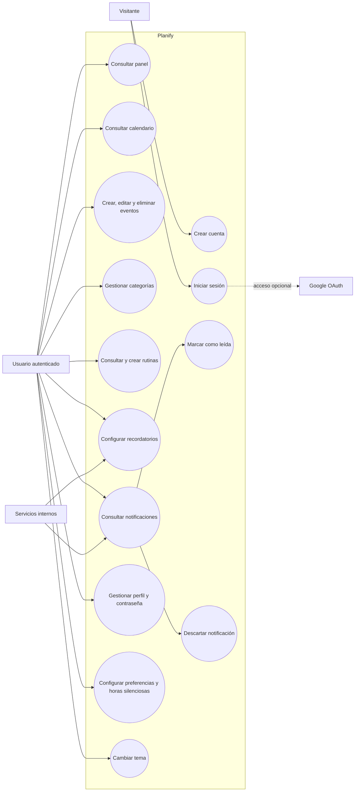

# Diagrama de casos de uso

El límite del sistema representa Planify como producto. El usuario interactúa con el gateway; los servicios internos colaboran para completar las operaciones.

La cobertura implementada de cada caso se detalla en [`../app/docs/trazabilidad.md`](../app/docs/trazabilidad.md); algunos requisitos de rutina y cancelación de alarmas todavía son parciales.
