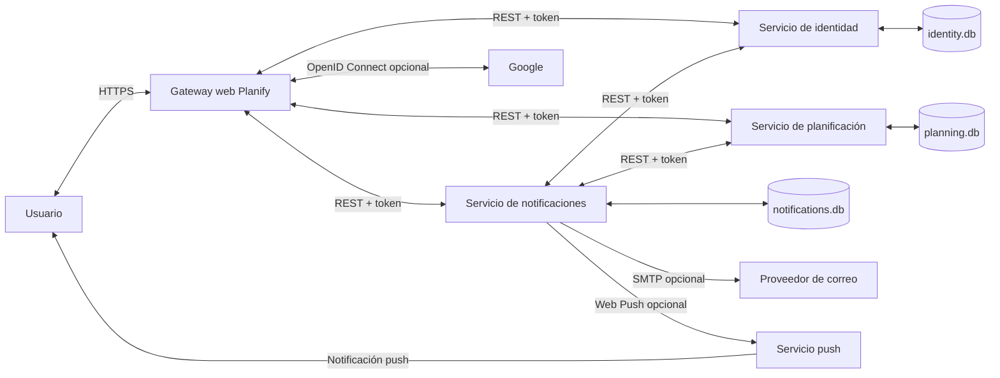

# Diagrama de contexto

Muestra al usuario y los sistemas externos que interactúan con Planify. Los servicios internos se comunican mediante REST autenticado y cada dominio conserva su propia base.

El gateway no consulta las bases directamente. El identificador de usuario se pasa en los DTO y se valida como propietario en cada servicio.
