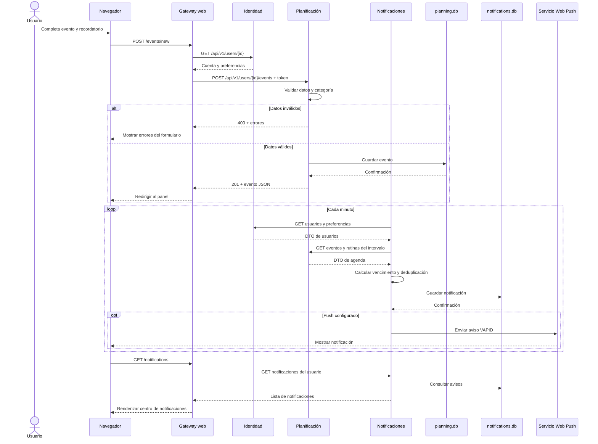

# Diagrama de secuencia

El flujo muestra el alta de un evento y la generación posterior del recordatorio. El scheduler no comparte base con planificación: consulta sus APIs periódicamente.

La creación del evento y el guardado del aviso son transacciones independientes en sus respectivas bases.
