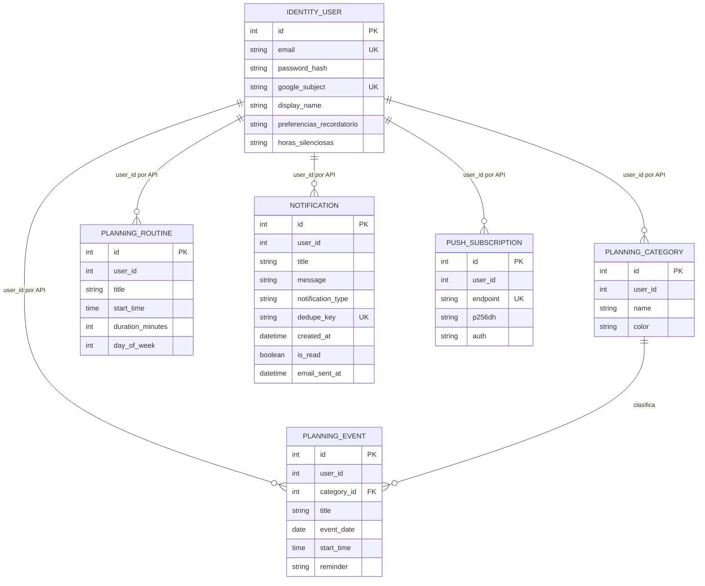

# Modelo de datos (notación Barker)

El diagrama es una vista lógica de las entidades del sistema. Las relaciones de `user_id` entre identidad y otros servicios se aplican mediante APIs; no son claves foráneas entre bases distintas.

## Propiedad por servicio

| Base | Entidades |
|---|---|
| `identity.db` | `IDENTITY_USER` y preferencias de cuenta. |
| `planning.db` | `PLANNING_CATEGORY`, `PLANNING_EVENT` y `PLANNING_ROUTINE`. |
| `notifications.db` | `NOTIFICATION` y `PUSH_SUBSCRIPTION`. |

`PLANNING_EVENT.category_id` es una relación real dentro de `planning.db`. El resto de las relaciones con `user_id` son referencias lógicas al identificador emitido por identidad. Las claves y atributos de este modelo se resumen para presentación; los modelos ORM de cada microservicio son la definición ejecutable.
